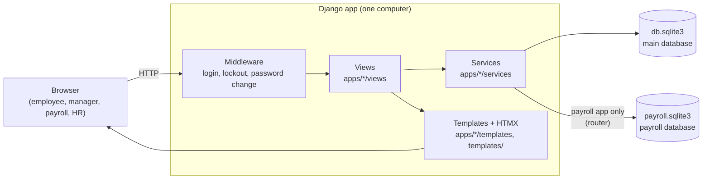
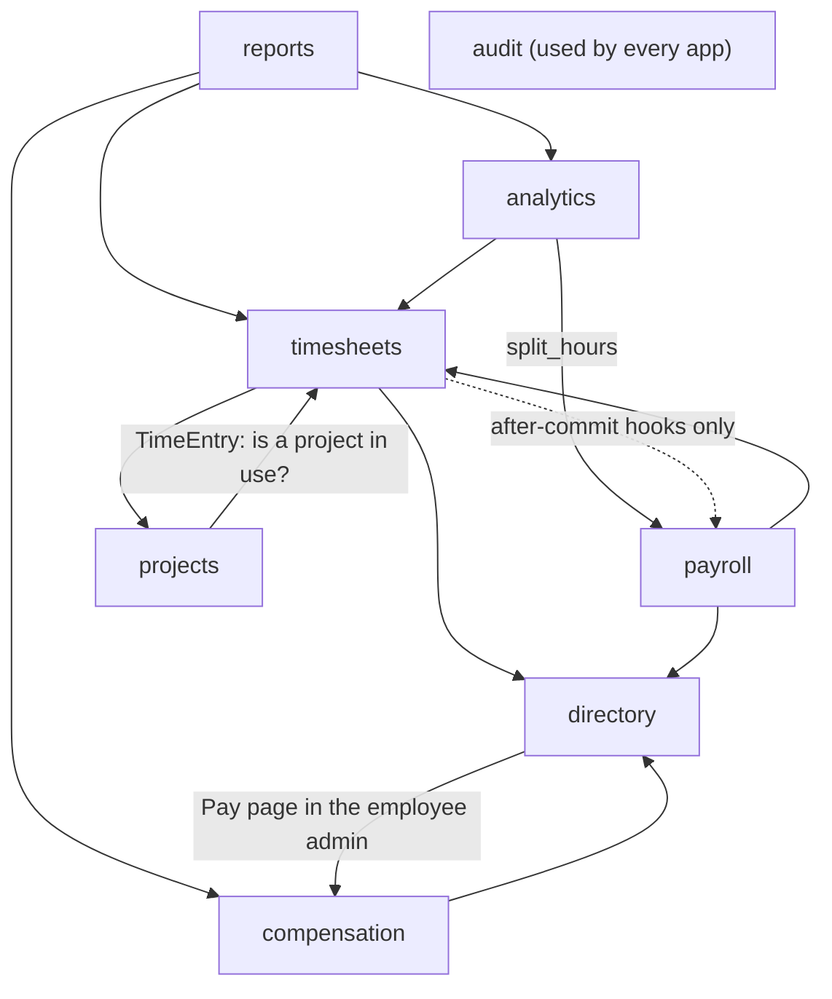
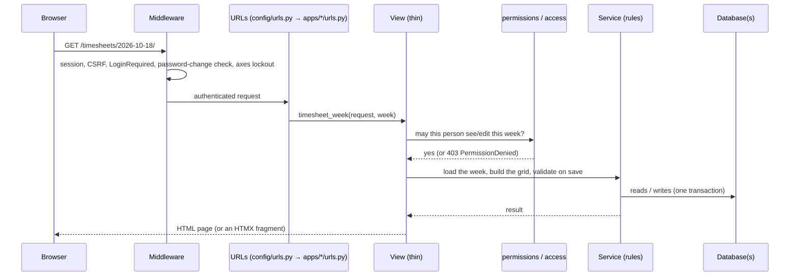
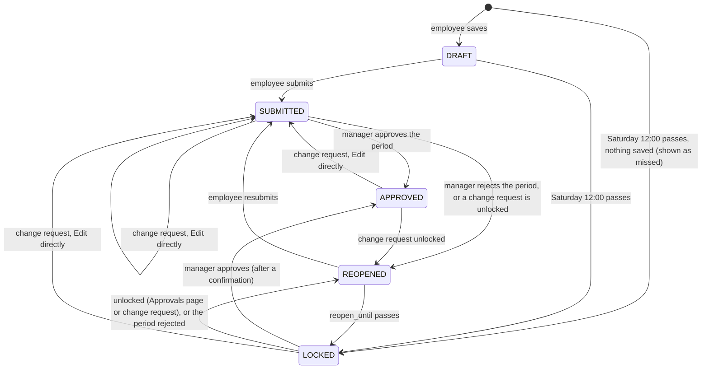
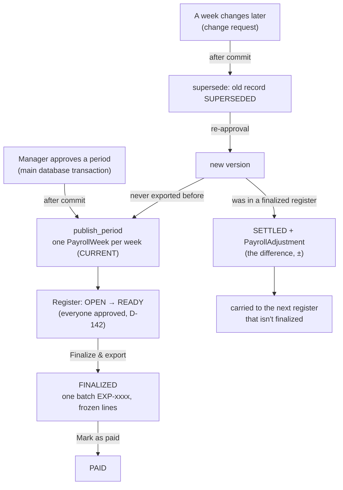

# Architecture

How the Employee Timesheet App is built: its apps, its two databases, how a request travels
through the code, where the rules live, who may see what, and why payroll records never change.
Decisions are linked as D-xx ([index](decisions/README.md)); a decision wins over this page.

- [Big picture](#big-picture)
- [The apps](#the-apps)
- [Two databases and the router](#two-databases-and-the-router)
- [How a request is handled](#how-a-request-is-handled)
- [The services pattern](#the-services-pattern)
- [Permissions](#permissions)
- [Timesheet status flow](#timesheet-status-flow)
- [Payroll: append-only by design](#payroll-append-only-by-design)
- [Data model](#data-model)
- [Pages](#pages)
- [Settings and configuration](#settings-and-configuration)
- [Tech stack](#tech-stack)

## Big picture

A Django 5.2 web app that runs on one computer. People log in with their company email; every
page is rendered on the server (Django templates + Bootstrap 5), with small interactive parts
done by HTMX and a few plain JavaScript files. There is no JavaScript build step and no cloud
service: Bootstrap, HTMX and Chart.js are saved in `static/vendor/`.



## The apps

Every app lives in `apps/` and is imported as `apps.<app>`; its **label** is the short name
(`directory`, `timesheets`, …), which is what table names, migrations and audit rows use
([D-174](decisions/D-174-refactor-r2-own-apps-everything-in-apps.md)).

| App | What it owns | Key places |
|---|---|---|
| `directory` | Employees, teams, login accounts (`User`), sign-up, the permission rules, the employee admin and CSV import/export, the demo seed, `backup_db` | `services/permissions.py`, `services/accounts.py`, `services/importer.py`, `services/directory_admin.py`, `services/demo/` |
| `timesheets` | Weeks, time entries, the weekly grid, change requests, period approvals | `services/calendar.py`, `services/validation.py`, `services/weeks.py`, `services/changes.py`, `services/approvals.py`, `services/pending.py`, `grid.py`, `views/` |
| `projects` | Projects (I-codes), tasks, allowed tasks per project, budgets, the project search | `services/projects.py`, `services/tasks.py`, `services/project_admin.py` |
| `compensation` | Employee pay records, the Pay pages and Pay CSV, who may see pay and costs | `services/pay.py`, `services/pay_import.py`, `services/access.py`, `admin.py` |
| `payroll` | The payroll database: week records, adjustments, registers; publishing, export, sync | `routers.py`, `services/publish.py`, `services/hours.py`, `services/adjustments.py`, `services/register/`, `services/export.py`, `services/sync.py` |
| `audit` | The audit log (who did what, before/after) | `services/log.py` |
| `analytics` | Personal Dashboard and Team pages (no tables) | `services/metrics.py`, `services/team.py` |
| `reports` | Reports → Project hours and Project budget, with Excel/CSV downloads (no tables) | `services/project_report/`, `services/project_costs.py`, `services/report_files.py`, `services/cost_files.py` |



An arrow means "imports from"; the main ones are shown. Every app writes audit rows through
`apps/audit/services/log.py`, and the demo seed (`apps/directory/services/demo/`) uses every app.
`timesheets` calls payroll only through two hooks (`publish_after_commit`,
`supersede_after_commit`, imported inside the functions that use them) so that payroll depends on
timesheets and not the other way round. Site-wide pieces stay outside the apps:
`config/` (settings, URLs), `templates/` (base page, error pages, login, shared includes) and
`static/` (`css/theme.css` and the vendored libraries).

## Two databases and the router

Approved hours are copied to a **separate payroll database**, so payroll can be backed up, handed
over or moved on its own (FR-11, [D-65](decisions/D-065-two-databases-fixed-order.md)).

```mermaid
flowchart LR
    subgraph default["db.sqlite3 (alias: default)"]
        d1[directory · timesheets · projects<br/>compensation · audit · axes · auth · sessions]
    end
    subgraph payroll["payroll.sqlite3 (alias: payroll)"]
        p1[PayrollWeek · PayrollAdjustment<br/>PayrollRegister · PayrollRegisterLine]
    end
    R{{"apps/payroll/routers.py<br/>PayrollRouter"}}
    R -- "label 'payroll'" --> payroll
    R -- "every other app" --> default
```

- `config/settings/base.py` defines both databases and `DATABASE_ROUTERS = ["apps.payroll.routers.PayrollRouter"]`.
- The router sends every read, write and migration of the `payroll` app to the payroll database,
  keeps every other app out of it, and refuses relations between the two.
- Payroll records hold **plain copies** (employee code, name, team, hours …), never foreign keys:
  Django cannot link across databases.
- Migrate both: `make migrate` (= `migrate` + `migrate --database=payroll`).

## How a request is handled



- **Middleware** (`config/settings/base.py`): security, sessions, CSRF, authentication,
  `LoginRequiredMiddleware` (every page needs a login except those marked
  `@login_not_required`: login and sign-up), messages, `PasswordChangeRequiredMiddleware`
  (after an HR password reset, [D-91](decisions/D-091-password-reset-by-hr.md)), clickjacking, and django-axes last (5 wrong
  passwords lock the account for 15 minutes).
- **HTMX** sends small requests for the grid (an empty row, a row action, the live day summary,
  the project search list); the server returns HTML fragments, never JSON for pages.
- **Static files** are served by `config/urls.py` also with `DEBUG` off (fine for one machine,
  [D-96](decisions/D-096-debug-off-for-daily-use.md)), with `Cache-Control: no-cache` so a new version is never mixed with old JS ([D-131](decisions/D-131-static-files-are-revalidated-on-every-page.md)).

## The services pattern

Business rules are plain, tested Python functions in each app's `services/` package — never in
views or templates ([D-04](decisions/D-004-every-app-uses-a-services-package.md)). Views stay thin: read the request, check permissions, call
a service, render. One rule lives in one place; for example:

| Rule | One place |
|---|---|
| Weeks, deadlines, pay periods, employment days | `apps/timesheets/services/calendar.py` (`week_start_for`, `deadline_for`, `effective_status`, `pay_period_for`, `expected_minutes_for`) |
| What a valid week is | `apps/timesheets/services/validation.py` (`validate_entries`) with `apps/projects/services/tasks.py` (`task_problem`) |
| Saving a week, Edit directly, the Approvals edit | `apps/timesheets/services/weeks.py` (`save_week`), `apps/timesheets/services/changes.py` (`edit_directly`, `edit_for_approval`) |
| Approve / reject / unlock — the only code that moves a week to or from APPROVED | `apps/timesheets/services/approvals.py` ([D-10](decisions/D-010-periodapproval-is-the-source-of-truth.md)) |
| Who may see / approve / edit whom | `apps/directory/services/permissions.py`; pay and costs: `apps/compensation/services/access.py` |
| Regular / overtime / leave split | `apps/payroll/services/hours.py` (`split_hours`) |
| Payroll publish / supersede / adjustments / registers | `apps/payroll/services/publish.py`, `adjustments.py`, `register/` |
| Project codes and project search | `apps/projects/services/projects.py` (`assign_code`, `search_projects`) |
| Pay in force and labour cost | `apps/compensation/services/pay.py` (`record_on`, `labour_cost`) |
| Report numbers | `apps/reports/services/project_report/` (hours) and `apps/reports/services/project_costs.py` (money) |
| Audit rows | `apps/audit/services/log.py` (`record`, `build`) |

Every manager, admin and payroll action writes an `AuditLog` row; actions by the app itself use
`system_actor` instead of `actor` ([D-14](decisions/D-014-auditlog-actor-becomes-nullable-plus-a-new.md)). Large services are packages whose `__init__.py`
re-exports their public names ([D-173](decisions/D-173-refactor-r1-the-code-layout.md)).

### Every core function

The full list of business-rule functions and where they live (numbered as in the original
specification).

| # | Function | Location |
|---|---|---|
| 1 | `week_start_for(d)` → Sunday of that Sunday→Saturday week (D-111); `week_days` Sun…Sat; `working_days` Mon–Fri (D-114) | `apps/timesheets/services/calendar.py` |
| 2 | `deadline_for(week_start, tz)` → Saturday 12:00 company time, the week's last day (D-112) | same |
| 3 | `effective_status(timesheet, now)` → DRAFT becomes LOCKED after deadline; REOPENED becomes LOCKED after `reopen_until` (D-08, D-21) | same |
| 4 | `pay_period_for(d, anchor)` → `(period_start, week1, week2)`; 14 days from a Sunday anchor, `ValueError` for any other day (D-113) | same |
| 5 | `expected_minutes_for(employee, week_start)` → `expected_weekly_minutes × active weekdays (Mon–Fri, within hire_date…end_date) / 5`; 0 for weeks fully outside employment (D-19) | same |
| 6 | `reporting_tree(employee)` → all reports, cycle-safe; built in memory from one `(id, manager_id)` query (D-86); `team_scope(viewer, scope)` → whole tree (everyone for admins) or direct reports, never the viewer (D-81) | `apps/directory/services/permissions.py` |
| 7 | `can_view`, `can_approve`, `can_edit`, `can_access_payroll` — `can_approve` = direct manager, or Admin for employees with no manager, never self (D-11); payroll flag grants nothing beyond `/payroll/` (D-12) | same |
| 8 | `sync_account(employee)` → copies is_admin → is_staff/is_superuser, status → is_active, email (lower-cased) → User (D-13, D-20) | `apps/directory/services/accounts.py` |
| 9 | `validate_entries(...)` → reason optional, ≤ 255 (D-36, D-128); work and Break rows: start/end in 15-min steps, end after start, same day (D-37), no overlaps (D-38); leave: hours only (D-40); dates in week and within hire_date…end_date (D-19); PROJECT ⇔ active project and an active task the project allows, other categories no task (D-151), Break never a project (D-18, D-39); work + Break + leave ≤ 24 h/day (D-42) | `apps/timesheets/services/validation.py` |
| 10 | `approve_period`, `reject_period`, `reset_approval`, `unlock_week` — the **only** code that moves a week to/from APPROVED, in one transaction with PeriodApproval (D-06, D-07, D-10); `unlock_week` and `reject_period` set `reopen_until` per D-21 | `apps/timesheets/services/approvals.py` |
| 11 | `check_signup_eligibility(email)` | `apps/directory/services/signup.py` |
| 12 | `split_hours(entries, expected)` → regular / overtime / PTO / sick / holiday; Break time is excluded from regular hours and overtime (D-45) | `apps/payroll/services/hours.py` |
| 13 | `publish_period(approval, …)` (idempotent, D-66; settles corrected versions of once-exported weeks and creates their adjustments, D-118–D-121), `supersede_week(...)`; run after the main commit by the timesheet hooks (D-65); `sync_payroll(at)` (also creates missing adjustments, D-125) | `apps/payroll/services/publish.py`, `apps/payroll/services/adjustments.py`, `apps/payroll/services/sync.py` |
| 14 | `export_period(...)` (whole period: CURRENT weeks + CURRENT adjustments, batch `EXP-0001`…, D-68, D-123), `batch_csv(...)` (WEEK and ADJUSTMENT rows; text cells spreadsheet-safe), `mark_paid(...)` (per batch, both kinds, D-69), `corrections()` (with adjustments, D-124), `carry_period(...)` (D-121) | `apps/payroll/services/export.py`, `apps/payroll/services/adjustments.py` |
| 15 | Dashboard and team metrics (on-time rate, overtime, hours by project, missed weeks): `dashboard_for`, `punctuality`, `overtime`, `hours_by_project`, `hours_by_task`, `hours_by_charge_code` ("Task not recorded" as its own line, D-153), `hours_by_category`, `approval_outcomes` — built on `week_state`, `summarize` and `split_hours` (D-74–D-79) | `apps/analytics/services/metrics.py` |
| 16 | `summarize(entries, employee, week_start)` → per day and week: Hours worked (work rows only), Break, Leave, expected, first start, last end (D-41) | `apps/timesheets/services/summary.py` |
| 17 | `approval_deadline_for(period_start)` → `APPROVAL_DEADLINE_DAYS` after the period's last day at `APPROVAL_DEADLINE_TIME`, company time (default Monday 12:00, D-133); `must_be_approved(employees, period_start)` → the one "who must be approved" rule, used per manager by `period_rows` and company-wide by `company_period_rows` (D-54, D-134) | `apps/timesheets/services/calendar.py`, `apps/timesheets/services/approvals.py` |
| 18 | `period_state(period_start, now)` → OPEN / READY (live) or FINALIZED / PAID (saved), approved x of y, why it isn't ready (D-132, D-133); `period_items` + `build_lines` → the register's lines from the PayrollWeek and PayrollAdjustment records only — the same code for the preview and for finalizing (D-134, D-136); `finalize(...)` (one batch, frozen lines, audit, D-135); `mark_paid(...)`; `register_csv(...)`; `build_registers(...)` for earlier exports (D-137); `closed_periods()` / `carry_period(...)` (D-136) | `apps/payroll/services/register/` (state, table, actions, backfill), `apps/payroll/services/adjustments.py` |
| 19 | `decision_blockers(row)` → the one rule for Approve / Reject (required weeks SUBMITTED or LOCKED; a REOPENED week waits; open change request blocks, D-139); `edit_blockers`, `unsubmitted_notes`, `pending_by_manager(period_start, now)` (D-143) in `apps/timesheets/services/approvals.py`; `edit_for_approval(viewer, employee, week_start, entries, now)` — the approver's edit from Approvals, status and submission time untouched (D-140) | `apps/timesheets/services/approvals.py` (`pending_by_manager`: `apps/timesheets/services/pending.py`), `apps/timesheets/services/changes.py` |
| 20 | `charge_code(project, task)` → "I-001-DEV" (project code alone without a task, D-150); `task_label`, `TASK_NOT_RECORDED`; `task_problem(project, task)` → the one task rule used by `validate_entries` and "+ Add row" / ⋮ (D-151); `task_choices()` → each active project's allowed active tasks for the grid dialogs (D-152). Admin: `save_task` and `set_project_tasks` (audited, D-148, D-149) | `apps/projects/services/tasks.py`, `apps/projects/services/project_admin.py` |
| 21 | `format_code(number)` → "I-007"; `next_number()` (1 + the highest number ever used); `assign_code(project)` — the only place a project gets its code, called by `project_admin.save_project` and `seed_demo` (D-155); `search_projects(text)` — the one project-search rule (I-code or name, partial, any case, active only, by I-code); `recent_projects(employee, week_start)` and `project_options(text, employee, week_start)` — what the search box lists (D-157, D-158) | `apps/projects/services/projects.py` |
| 22 | `project_report(viewer, params, now)` → the one ProjectReport the page, the Excel and the CSV use (D-160–D-164): `read_filters` (period → whole Sunday–Saturday weeks with calendar.py, projects, Hours, scope, group), `report_people` (own hours, or the viewer + tree / direct reports / one manager's group via `manager_map` / `reporting_tree_ids`; 403 outside), `build_report` (project hours, non-project time, total time, by project / task / project × task / week / team / manager with roll-up, By employee with 0.00 notes, the Detail); `report_files.workbook` / `detail_csv` / `file_name` / `audit_download` (layout only; `safe_cell`) | `apps/reports/services/project_report/` (constants, filters, scope, rows, aggregate, queries), `apps/reports/services/report_files.py` |
| 23 | `suggested_hourly(salary)` (÷ 2,080, half-up to cents), `labour_cost(minutes, rate)` (hours × rate, cents), `rate_index(ids)` / `record_on(records, day)` (the pay in force: latest effective_from ≤ day, newest for a tie), `check_pay`, `add_pay` (audited) — the only pay rules (D-166); `pay_import.export_pay` / `import_pay` (D-167) | `apps/compensation/services/pay.py`, `apps/compensation/services/pay_import.py` |
| 24 | `project_costs(viewer, params, now)` → the one CostReport the Project budget page, the costs Excel and CSV use: the Project hours report with Approved only (`everyone` for payroll and admins), each Project-work entry priced, per-project budget figures from the whole project's approved cost since costs_from, breakdowns, Rate missing; `budget_status(budget, cost)` with BUDGET_AT_RISK_PERCENT / BUDGET_OVER_PERCENT; `cost_files.workbook` / `detail_csv` (layout only) | `apps/reports/services/project_costs.py`, `apps/reports/services/cost_files.py` |

## Permissions

Roles **add up** ([D-12](decisions/D-012-roles-add-up.md)); everything is checked on the server for every page, filter and
download — hiding a menu item is never the only protection.

| Who | How they get it | What they can see and do |
|---|---|---|
| Everyone | an ACTIVE employee with an account | own timesheets, change requests, Dashboard, Reports → Project hours (own hours) |
| Manager | automatic: anyone with at least one report | + Team and Approvals for their whole reporting tree (direct + indirect); approves **direct** reports; Change-request inbox; Project hours and Project budget for their tree |
| Payroll | `is_payroll` flag | + Payroll pages and Project budget for everyone (view only); nothing else about other people |
| Admin (HR) | `is_admin` flag | + Django Admin (employees, teams, projects, tasks, budgets, **pay**), everyone's Team and reports; approves people with no manager |

- **Nobody approves their own timesheet** ([D-11](decisions/D-011-nobody-can-ever-approve-their-own-timesheet.md)); the CEO is approved by HR.
- `User.is_staff` / `is_superuser` follow `is_admin`, and `User.is_active` follows the employee's
  status, on every save ([D-13](decisions/D-013-keep-user-is-staff-and-is-superuser.md)).
- Pay (salaries, pay history, the Pay CSV) is **admins only** ([D-167](decisions/D-167-only-admins-see-or-change-pay.md)); managers see their
  tree's hourly rates and costs on Project budget, never salaries ([D-170](decisions/D-170-reports-project-budget-who-sees-what.md)).
- Helpers: `can_view`, `can_approve`, `can_edit`, `can_access_payroll`, `team_scope`, `menu_for`
  in `apps/directory/services/permissions.py`; `can_manage_pay`, `can_see_costs`,
  `can_see_everyones_costs` in `apps/compensation/services/access.py`.

## Timesheet status flow

A week (Sunday → Saturday, identified by its Sunday) has one status. DRAFT and REOPENED weeks turn
LOCKED **when read** after their deadline — no background job ([D-08](decisions/D-008-when-a-reopen-window-unlock-or-reject.md)).



When an APPROVED week is unlocked or edited directly, its period goes back to PENDING and every
approved week of that period returns to SUBMITTED (`reset_approval` in
`apps/timesheets/services/approvals.py`). An edit from the Approvals page changes the entries but
not the status, and never sets `submitted_at` (D-140).

- **Deadline:** Saturday 12:00 company time (`COMPANY_TZ`), the week's last day ([D-112](decisions/D-112-the-deadline-stays-saturday-12-00-noon.md)).
- **Reopen window:** `reopen_until` = the later of +48 hours and the week's Saturday 12:00 ([D-21](decisions/D-021-reopen-window.md)).
- **Approvals** are per two-week **pay period** counted from the Sunday `PAY_PERIOD_ANCHOR`;
  a period can be decided once its required weeks are submitted **or locked** (a locked week is
  approved with what was entered, after a confirmation, and still counts as missed) ([D-139](decisions/D-139-managers-decide-every-required-person.md)–[D-141](decisions/D-141-not-submitted-by-employee.md)).
- Editing a week in an approved period sets the approval back to PENDING in the same
  transaction and supersedes its payroll record ([D-10](decisions/D-010-periodapproval-is-the-source-of-truth.md)).

## Payroll: append-only by design

Payroll records are never edited or deleted: a change is a new record, so what was paid can
always be traced ([D-15](decisions/D-015-append-only-means-snapshot-and-hours-fields.md), [D-67](decisions/D-067-append-only-d-15-enforced-in-code.md)).



- **Frozen fields:** a record's snapshot and hours never change; only the lifecycle fields move,
  and only forward (CURRENT → EXPORTED → PAID; → SUPERSEDED; CURRENT → SETTLED). The models'
  `save()`, `delete()` and their QuerySets refuse anything else (`AppendOnlyError`).
- **After commit:** payroll is written only after the main transaction commits
  (`transaction.on_commit` in `apps/payroll/services/publish.py`), so a failed approval never
  leaves payroll rows behind. `publish_period` is **idempotent**; `sync_payroll` re-checks every
  approved period and fills anything missing ([D-66](decisions/D-066-a-payroll-record-belongs-to-one-approval.md), [D-125](decisions/D-125-audit-and-sync.md)).
- **Registers** (Change 8–9): one per pay period; READY only when everyone who must be approved
  is approved; **Finalize & export** saves it once as one batch; **Mark as paid** closes it
  ([D-132](decisions/D-132-pay-period-register.md)–[D-138](decisions/D-138-pages.md), [D-142](decisions/D-142-the-register-waits-for-everyone.md)).
- **Adjustments** (Change 4): the difference between a paid week and its corrected version,
  carried forward ([D-118](decisions/D-118-settled-weeks.md)–[D-126](decisions/D-126-seed.md)).
- Pay amounts (salaries, rates) are **not** payroll records: they live in `compensation` and are
  used only for project costs ([D-169](decisions/D-169-cost-rules.md)).

## Data model

Main database (`db.sqlite3`):

| App | Model | Notes |
|---|---|---|
| directory | `Team` | name, department |
| directory | `Employee` | the directory: code, email, names, job title, team, manager (self-link), location, hire/end dates, status, expected weekly minutes, `is_admin`, `is_payroll` |
| directory | `User` | login account (custom, email login, `AUTH_USER_MODEL = "directory.User"`), one per employee ([D-02](decisions/D-002-custom-usermanager-with-email-login.md)) |
| projects | `Task`, `Project` | I-code, name, active, allowed tasks (many-to-many), budget, costs-from date; tables still `timesheets_task`, `timesheets_project`, `timesheets_project_tasks` ([D-174](decisions/D-174-refactor-r2-own-apps-everything-in-apps.md)) |
| timesheets | `Timesheet` | one per employee per week: status, submitted_at, is_late, reopen_until, manager note |
| timesheets | `TimeEntry` | date, category, project + task (Project work only), start/end times (work and Break), minutes, reason |
| timesheets | `PeriodApproval` | one per employee per pay period: PENDING / APPROVED / REJECTED, approver, comment |
| timesheets | `ChangeRequest` | a request to change a week: OPEN / REJECTED / UNLOCKED / EDITED |
| compensation | `PayRecord` | pay history, append-only: SALARIED or HOURLY, salary, hourly rate, effective from; table `directory_payrecord` ([D-166](decisions/D-166-employee-pay-is-history.md)) |
| audit | `AuditLog` | action, entity, actor or system actor, before/after, linked change request |

Payroll database (`payroll.sqlite3`): `PayrollWeek` (one live record per employee and week;
versions), `PayrollAdjustment`, `PayrollRegister` and `PayrollRegisterLine` — all append-only.

Durations are whole **minutes** (shown as hours with 2 decimals); work dates are `DateField`;
moments are stored in UTC and shown in company time; money is `Decimal`, never float.

## Pages

| Address | Who | What |
|---|---|---|
| `/login/`, `/signup/`, `/logout/` | everyone | log in; sign up with a directory email |
| `/` | everyone | Dashboard (own) |
| `/profile/` | everyone | directory details; change password |
| `/timesheets/`, `/timesheets/<week>/` | everyone | own weeks; the weekly grid (Save draft, Submit, Request change) |
| `/requests/` | everyone | own change requests |
| `/team/`, `/team/<code>/`, `/team/<code>/weeks/<week>/` | managers, admins | Team; read-only drill-down |
| `/approvals/`, `/approvals/<period>/<code>/`, `…/weeks/<week>/edit/`, `/approvals/bulk/` | managers, admins | period approvals; edit a submitted or locked week; bulk approve |
| `/approvals/requests/`, `/approvals/requests/<id>/`, `…/edit/` | the request's handler | change-request inbox; reject, unlock, Edit directly |
| `/reports/project-hours/` (+ `excel/`, `csv/`) | everyone (own); managers (tree); admins (all) | Project hours report |
| `/reports/project-budget/` (+ `excel/`, `csv/`) | managers, payroll, admins | Project budget and labour cost |
| `/payroll/`, `/payroll/periods/<period>/` (+ `finalize/`, `paid/`, `register.csv`, `detail.csv`), `/payroll/registers.csv`, `/payroll/pending/` (+ `.csv`), `/payroll/corrections/`, `/payroll/batches/<batch>.csv` | payroll, admins | registers, downloads, who is pending, corrections |
| `/admin/` | admins | Django Admin; projects and tasks under **Projects**; pay on each employee (`/admin/directory/employee/<id>/pay/`) |

HTMX helpers (not pages): `…/row/`, `…/rows/`, `…/totals/`, `…/projects/` under each week editor,
and `/reports/projects/` (the report's project search).

## Settings and configuration

Settings are a package ([D-173](decisions/D-173-refactor-r1-the-code-layout.md)): `config/settings/base.py` (shared; reads `.env`), `local.py`
(the default for `manage.py`, `wsgi.py`, `asgi.py`), `test.py` (pytest) and `production.py`
(a skeleton for a future server with PostgreSQL and HTTPS — **not used yet**). Values come from
`.env` (never committed; template: `.env.example`):

| Setting | Meaning | Default |
|---|---|---|
| `DJANGO_SECRET_KEY` | long random secret; the example value is refused ([D-145](decisions/D-145-the-secret-key-can-t-stay-the.md)) | — (required) |
| `DJANGO_DEBUG` | `True` only while developing ([D-96](decisions/D-096-debug-off-for-daily-use.md)) | `False` |
| `DJANGO_ALLOWED_HOSTS` | host names the app answers to | `127.0.0.1,localhost` |
| `COMPANY_EMAIL_DOMAIN` | sign-up accepts only this domain | `@yourcompany.com` |
| `COMPANY_TZ` | deadlines are computed in this time zone | `America/Chicago` |
| `PAY_PERIOD_ANCHOR` | the Sunday that starts pay period 1; a non-Sunday stops the app ([D-113](decisions/D-113-pay-periods.md)) | `2026-01-04` |
| `APPROVAL_DEADLINE_DAYS`, `APPROVAL_DEADLINE_TIME` | managers approve by this many days after a period ends, at this time ([D-133](decisions/D-133-approval-deadline-and-ready.md)) | `2`, `12:00` (Monday noon) |
| `BUDGET_AT_RISK_PERCENT`, `BUDGET_OVER_PERCENT` | budget status thresholds ([D-169](decisions/D-169-cost-rules.md)) | `80`, `100` |
| `DEMO_PASSWORD` | password of every `seed_demo` account; the example value is refused ([D-146](decisions/D-146-seed-demo-refuses-the-example-demo-password.md)) | — |

## Folder layout

```
config/
  settings/       base.py (shared, reads .env) · local.py (the default) · test.py (pytest)
                  · production.py (a skeleton for a future server, not used yet)
  urls.py  wsgi.py  asgi.py
apps/             the Django apps, imported as apps.<app>; business rules in each app's
                  services/; each app has its own templates/<app>/ and static/<app>/
  directory/  timesheets/  projects/  compensation/  payroll/  audit/  analytics/  reports/
templates/        site-wide pages: base, errors, login, shared includes (status badge, fields)
static/           css/theme.css · vendor/ (Bootstrap 5, HTMX, Chart.js — no JS build step)
data/             employees_core.csv (the 13 core demo people)
tests/            conftest.py · factories.py · <app>/unit/ · <app>/integration/ · site/ · e2e/
scripts/          test_all.sh · doctor.sh · visual_review/ (screenshots)
docs/             this documentation
Makefile          everyday commands (make help)
```

## Look and feel

One theme stylesheet, `static/css/theme.css`, styles every page on top of the vendored Bootstrap:
colours, spacing, corners and shadows are CSS variables (`--ts-*`) at its top, so a brand colour
changes in one place ([D-100](decisions/D-100-modern-ui-one-theme-stylesheet.md)). Fonts are the system fonts. Week, period, request and payroll
statuses always use the same badge component, `templates/includes/status_badge.html`
([D-102](decisions/D-102-one-status-badge-component.md)); charts take their colours from the same variables ([D-103](decisions/D-103-charts-use-the-tokens.md)).

## Tech stack

Python 3.13 (managed by uv), Django 5.2 LTS, two SQLite databases, django-environ, Argon2
(`argon2-cffi`) password hashing, django-axes (login lockout), Faker (demo data), openpyxl (Excel
downloads); Django templates + Bootstrap 5 + HTMX + Chart.js (saved locally, no build step);
pytest, pytest-django, factory_boy, time-machine, pytest-cov and Playwright for tests; Ruff for
lint. Notifications are out of scope for version 1.
